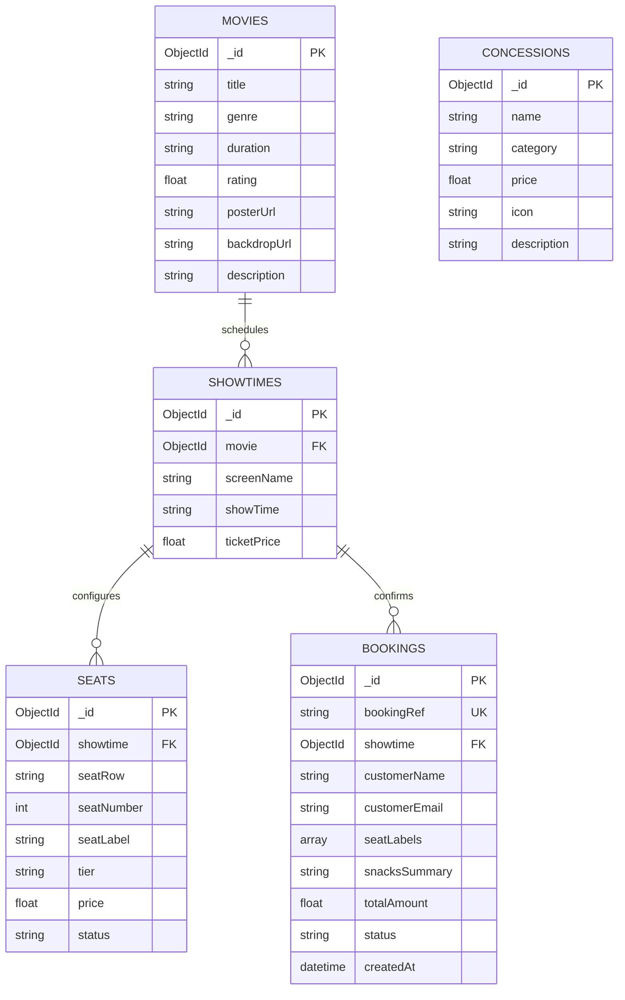

# CinePass — Full-Stack Cinema Ticket Booking Platform with Atomic Concurrency Control (MERN Stack)

[](https://nodejs.org)
[](https://expressjs.com)
[](https://www.mongodb.com)
[](https://react.dev)
[](https://vitejs.dev)
[-crimson.svg)](#-atomic-concurrency-control--double-booking-prevention)

A production-ready **MERN stack** (MongoDB Atlas, Express, React 18, Node.js) cinema and event reservation platform. Engineered to solve one of the most critical challenges in high-traffic ticketing systems: **atomic double-booking prevention** when concurrent users attempt to reserve the same seat simultaneously.

---

## 🌟 Key Features

- **Interactive IMAX Seating Matrix**: 40-seat interactive cinema auditorium grid color-coded by tiers (Standard $12.00, Premium $16.00, VIP Recliner $22.00) with live selection badges and dynamic pricing recalculation.
- **Atomic Concurrency Control (Double-Booking Prevention)**: Backend atomic reservation powered by MongoDB conditional updates (`status: 'AVAILABLE'`). If another user reserves a seat milliseconds before you, the conditional update detects the conflict, rolls back partial locks, and returns an HTTP `409 Conflict` error without corrupted state.
- **Race Condition Simulator**: Dedicated one-click button in the UI (`Simulate Race Condition`) allowing recruiters and interviewers to trigger simultaneous synthetic booking attempts and observe conflict rejection in real time.
- **Concessions & Gourmet Snack Add-Ons**: Integrated cinema snack bar (Popcorn Combos, Truffle Nachos, Artisan Sweets, Slushies) with live cart calculation and itemized receipts.
- **Digital Boarding Pass & QR Receipts**: Instant booking confirmation with reference codes (`CP-XXXXX`), customer email routing, and one-click booking cancellation with immediate seat liberation.
- **Atmospheric Dark-Mode Cinema UI**: Immersive movie banner backdrops, glowing curved theater screen, responsive mobile drawer, and visual feedback on reservation.

---

## 🏗️ Architecture & Project Structure

```text
ticket-booking-project/
├── backend/
│   ├── config/
│   │   └── db.js                     # MongoDB connection & auto-seeding (Movies, Showtimes, 40 Seats, Concessions)
│   ├── models/
│   │   ├── Movie.js                  # Mongoose schema for cinema films
│   │   ├── Showtime.js               # Mongoose schema for auditorium show schedules
│   │   ├── Seat.js                   # Mongoose schema for tiered seats with compound unique index
│   │   ├── Booking.js                # Mongoose schema for customer booking passes
│   │   └── Concession.js             # Mongoose schema for cinema snacks catalog
│   ├── controllers/
│   │   └── ticketController.js       # Atomic booking engine, server-side pricing & race condition simulator
│   ├── routes/
│   │   └── api.js                    # REST API endpoints for movies, seats, concessions & bookings
│   ├── .env.example                  # Template with MONGODB_URI
│   ├── package.json
│   └── server.js                     # Express server listening on port 4006
├── frontend/
│   ├── src/
│   │   ├── App.jsx                   # Single-page Cinema application: Movie selector, Seat Matrix, Snacks & Modal
│   │   ├── index.css                 # Cinema theme styles, glowing auditorium screen, seat status classes
│   │   └── main.jsx                  # React DOM entrypoint
│   ├── index.html                    # HTML5 shell with Bootstrap 5.3 & cinema styling
│   ├── package.json
│   └── vite.config.js                # Vite development server (port 3006) with /api proxy to port 4006
├── package.json                      # Root workspace scripts (npm start / npm run dev)
├── run.bat                           # 1-Click Windows execution script
├── start.js                          # Cross-platform concurrency launcher
├── .env.example
└── README.md
```

---

## 🛡️ Atomic Concurrency Control & Double-Booking Prevention

In high-concurrency ticket booking, naive implementations read seat status and update it in separate operations. If User A and User B both view Seat `C4` as `AVAILABLE` and click "Book" simultaneously, both payments would be processed and the seat would be double-booked.

### How CinePass Solves This with MongoDB:
```text
Client Request: POST /api/bookings { showtimeId, seats: ['C4', 'C5'] }
                      │
                      ▼
        [Step 1: Verify No Seats Currently BOOKED]
        Seat.find({ showtime, seatLabel: { $in: ['C4', 'C5'] }, status: 'BOOKED' })
                      │
         ┌────────────┴────────────┐
         │                         │
   [Any seat BOOKED]        [All seats AVAILABLE]
         │                         │
         ▼                         ▼
Return HTTP 409 Conflict    [Step 2: Atomic Conditional Lock]
("Double-booking prevented") Seat.updateMany(
                               { showtime, seatLabel: { $in: seats }, status: 'AVAILABLE' },
                               { $set: { status: 'BOOKED' } }
                             )
                                   │
                    ┌──────────────┴──────────────┐
                    │                             │
       [modifiedCount !== seats.length]  [All seats locked]
                    │                             │
                    ▼                             ▼
       Rollback partial locks &          [Step 3: Server-side Pricing Verification]
       Return HTTP 409 Conflict          [Step 4: Booking.create()]
                                                  │
                                                  ▼
                                         Return HTTP 201 Created
                                         (Issue Digital Pass CP-48291)
```

---

## 🗄️ MongoDB Document Models (Mongoose)



---

## 🚀 API Endpoints Reference

| Method | Endpoint | Request Body | Description |
| :--- | :--- | :--- | :--- |
| `GET` | `/api/movies` | *(None)* | Returns all movies currently in theaters |
| `GET` | `/api/movies/:movieId/showtimes` | *(None)* | Fetches showtimes and screens for specified movie |
| `GET` | `/api/showtimes/:showtimeId/seats` | *(None)* | Retrieves 40-seat matrix with tier, price, and booking status |
| `GET` | `/api/concessions` | *(None)* | Retrieves theater snacks, combos, and beverages |
| `POST` | `/api/bookings` | `{ showtimeId, customerName, customerEmail, selectedSeats, selectedSnacks }` | **Atomic booking reservation**; returns `201 Created` or `409 Conflict` |
| `DELETE` | `/api/bookings/:bookingRef` | *(None)* | Cancels booking and instantly unlocks reserved seats to `AVAILABLE` |
| `POST` | `/api/bookings/simulate-collision` | `{ showtimeId, seatLabel }` | Simulates a race condition collision on a targeted seat |
| `GET` | `/api/bookings/recent` | *(None)* | Retrieves the latest confirmed reservations |
| `GET` | `/api/health` | *(None)* | Health check returning MongoDB Atlas connection status |

---

## 💻 Quick Start & Installation

### Prerequisites
- Node.js (v18.0.0 or higher)
- npm (v9.0.0 or higher)
- MongoDB (Local MongoDB instance or free MongoDB Atlas cloud cluster)

### Option 1: One-Click Launch (Windows)
Double-click `run.bat` in the project root directory. It runs setup and launches both backend and frontend automatically.

### Option 2: Manual Terminal Setup

1. **Clone the repository**:
   ```bash
   git clone https://github.com/siddiquddin/ticket-booking-project.git
   cd ticket-booking-project
   ```

2. **Configure Environment Variables**:
   ```bash
   cp backend/.env.example backend/.env
   # Default connects to mongodb://127.0.0.1:27017/ticket_booking
   ```

3. **Install dependencies**:
   ```bash
   cd backend && npm install
   cd ../frontend && npm install
   cd ..
   ```

4. **Start both backend and frontend concurrently**:
   ```bash
   npm start
   ```

- **Frontend Application**: `http://localhost:3006`
- **Backend REST API**: `http://localhost:4006`

---

## 🎤 Interview Talking Points & Technical Highlights

When presenting this project in technical interviews:

1. **Handling Distributed Concurrency & Race Conditions**:
   *"In ticketing applications, the biggest architectural hazard is double-booking. I solved this by leveraging atomic conditional updates in MongoDB (`status: 'AVAILABLE'`). If another client attempts to reserve any seat concurrently, the write detects the state discrepancy, rolls back partial changes, and immediately returns an HTTP 409 Conflict error."*
2. **Server-Side Price Validation**:
   *"Client-side prices can easily be tampered with in browser DevTools. Instead of trusting prices submitted from the frontend, the backend queries the database for each selected seat's tier price and calculates the definitive order total server-side."*
3. **Compound Unique Indexing**:
   *"To guarantee structural integrity at the database engine level, I added a compound unique index on `{ showtime: 1, seatLabel: 1 }`, making it impossible for duplicate seat records to ever exist."*
4. **Interactive Race Condition Testing**:
   *"I built an interactive test harness right into the frontend (`Simulate Race Condition`), which allows interviewers to witness conflict resolution and rollback handling live."*

---

## 📄 License

This project is licensed under the MIT License. Open source and free for educational and portfolio use.
