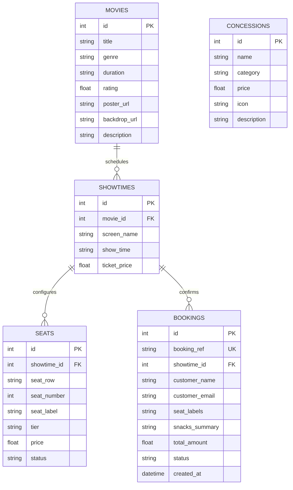

# CinePass — Full-Stack Cinema Ticket Booking Platform with Atomic Concurrency Control

[](https://nodejs.org)
[](https://expressjs.com)
[](https://react.dev)
[](https://vitejs.dev)
[](https://www.sqlite.org)
[-crimson.svg)](#-atomic-concurrency-control--double-booking-prevention)

A full-stack movie theater reservation system built with React 18, Express, and SQLite3. Engineered to solve one of the most critical challenges in high-traffic ticketing systems: **atomic double-booking prevention** when concurrent users attempt to reserve the same seat simultaneously.

---

## 🌟 Key Features

- **Interactive IMAX Seating Matrix**: 40-seat interactive cinema auditorium grid color-coded by tiers (Standard $12.00, Premium $16.00, VIP Recliner $22.00) with live selection badges and dynamic pricing recalculation.
- **Atomic Concurrency Control (Double-Booking Prevention)**: Backend transactions wrapped in SQLite `BEGIN TRANSACTION` ... `COMMIT` / `ROLLBACK`. If another user reserves a seat milliseconds before you, the transaction aborts and returns an HTTP `409 Conflict` error without partial writes.
- **Race Condition Simulator**: Dedicated one-click button in the UI (`Simulate Race Condition`) allowing interviewers to trigger simultaneous synthetic booking attempts and observe transaction rollbacks and conflict rejection in real time.
- **Concessions & Gourmet Snack Add-Ons**: Integrated cinema snack bar (Popcorn Combos, Truffle Nachos, Artisan Sweets, Slushies) with live cart calculation and itemized receipts.
- **Digital Boarding Pass & QR Receipts**: Instant booking confirmation with reference codes (`CP-XXXXX`), customer email routing, and one-click booking cancellation with seat liberation.
- **Atmospheric Dark-Mode Cinema UI**: Immersive movie banner backdrops, glowing curved theater screen, responsive mobile drawer, and sound/visual feedback on reservation.

---

## 🏗️ Architecture & Project Structure

```text
ticket-booking-project/
├── backend/
│   ├── config/
│   │   ├── db.js                     # SQLite schema initialization (Movies, Showtimes, Seats, Bookings, Concessions)
│   │   └── ticket_booking.db         # Persistent SQLite database with foreign keys enabled
│   ├── controllers/
│   │   └── ticketController.js       # Atomic booking transaction engine, pricing logic & race condition simulator
│   ├── routes/
│   │   └── api.js                    # REST API endpoints for movies, seats, concessions & bookings
│   ├── package.json
│   └── server.js                     # Express server, CORS & JSON body-parser configuration
├── frontend/
│   ├── src/
│   │   ├── App.jsx                   # Single-page Cinema application: Movie selector, Seat Matrix, Snacks & Modal
│   │   ├── index.css                 # Cinema theme styles, glowing auditorium screen, seat status classes
│   │   └── main.jsx                  # React DOM entrypoint
│   ├── index.html                    # HTML5 shell with cinema typography
│   ├── package.json
│   └── vite.config.js                # Vite development server with /api proxy to port 5000
├── package.json                      # Workspace root scripts (dev, install:all)
├── run.bat                           # 1-Click Windows execution script
├── start.js                          # Node cross-platform concurrency launcher
└── README.md
```

---

## 🛡️ Atomic Concurrency Control & Double-Booking Prevention

In high-concurrency ticket booking, naive implementations read seat status and update it in separate operations. If User A and User B both view Seat `C4` as `AVAILABLE` and click "Book" simultaneously, both payments would be processed and the seat would be double-booked.

### How CinePass Solves This:
```text
Client Request: POST /api/bookings { showtimeId: 1, seats: ['C4', 'C5'] }
                      │
                      ▼
             db.run('BEGIN TRANSACTION')
                      │
                      ▼
       [Step 1: Check Seat Status with Row Lock]
       SELECT seat_label, tier, price FROM seats 
       WHERE showtime_id = ? AND seat_label IN ('C4', 'C5') AND status = 'BOOKED';
                      │
        ┌─────────────┴─────────────┐
        │                           │
  [Any seat is BOOKED]      [All seats AVAILABLE]
        │                           │
        ▼                           ▼
db.run('ROLLBACK')          [Step 2: Calculate Exact DB Total]
        │                   [Step 3: UPDATE seats SET status = 'BOOKED']
        ▼                   [Step 4: INSERT INTO bookings]
Return HTTP 409 Conflict            │
("Seat C4 was already booked")      ▼
                            db.run('COMMIT')
                                    │
                                    ▼
                            Return HTTP 201 Created
                            (Issue Digital Pass CP-48291)
```

---

## 🗄️ Database Schema & Relationships



---

## 🚀 API Endpoints Reference

| Method | Endpoint | Request Body | Description |
| :--- | :--- | :--- | :--- |
| `GET` | `/api/movies` | *(None)* | Returns all movies currently in theaters |
| `GET` | `/api/movies/:movieId/showtimes` | *(None)* | Fetches showtimes and screens for specified movie |
| `GET` | `/api/showtimes/:showtimeId/seats` | *(None)* | Retrieves 40-seat matrix with tier, price, and booking status |
| `GET` | `/api/concessions` | *(None)* | Retrieves theater snacks, combos, and beverages |
| `POST` | `/api/bookings` | `{ showtimeId, customerName, customerEmail, selectedSeats, selectedSnacks }` | **Atomic booking transaction**; returns `201 Created` or `409 Conflict` |
| `DELETE` | `/api/bookings/:bookingRef` | *(None)* | Cancels booking and instantly unlocks reserved seats |
| `POST` | `/api/bookings/simulate-collision` | `{ showtimeId, seatLabel }` | Simulates a race condition collision on a targeted seat |
| `GET` | `/api/bookings/recent` | *(None)* | Retrieves the latest confirmed reservations |

---

## 💻 Quick Start & Installation

### Prerequisites
- Node.js (v18.0.0 or higher)
- npm (v9.0.0 or higher)

### Option 1: One-Click Launch (Windows)
Double-click `run.bat` in the project root directory. It runs setup and launches both backend and frontend automatically.

### Option 2: Manual Terminal Setup

1. **Clone the repository**:
   ```bash
   git clone https://github.com/siddiquddin/ticket-booking-project.git
   cd ticket-booking-project
   ```

2. **Install all dependencies**:
   ```bash
   npm run install:all
   ```

3. **Start both backend and frontend concurrently**:
   ```bash
   npm run dev
   ```

- **Frontend Application**: `http://localhost:5173`
- **Backend REST API**: `http://localhost:5000`

---

## 🎤 Interview Talking Points & Technical Highlights

When presenting this project in technical interviews:

1. **Handling Distributed Concurrency & Race Conditions**:
   *"In ticketing applications, the biggest architectural hazard is double-booking. I solved this by wrapping seat verification and status updates inside ACID database transactions (`BEGIN TRANSACTION`). If another thread or client books any requested seat, the entire operation is rolled back and an HTTP 409 Conflict error is returned."*
2. **Server-Side Price Validation**:
   *"Client-side prices can easily be tampered with in browser DevTools. Instead of trusting prices submitted from the frontend, the backend queries the database for each selected seat's tier price and calculates the definitive order total server-side."*
3. **Optimistic vs. Pessimistic Locking**:
   *"I can explain the tradeoffs between pessimistic locking (database transactions holding exclusive locks during writes) and optimistic locking (version numbers on seat records). For this project, transaction serialization guarantees 100% seat integrity."*
4. **Interactive Race Condition Testing**:
   *"I built an interactive test harness right into the frontend (`Simulate Race Condition`), which allows interviewers to witness conflict resolution and rollback handling live."*

---

## 📄 License

This project is licensed under the MIT License. Open source and free for educational and portfolio use.
